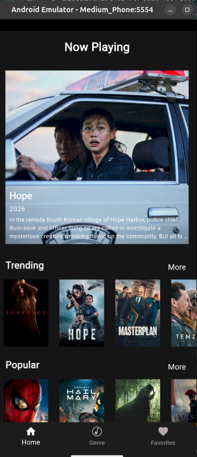
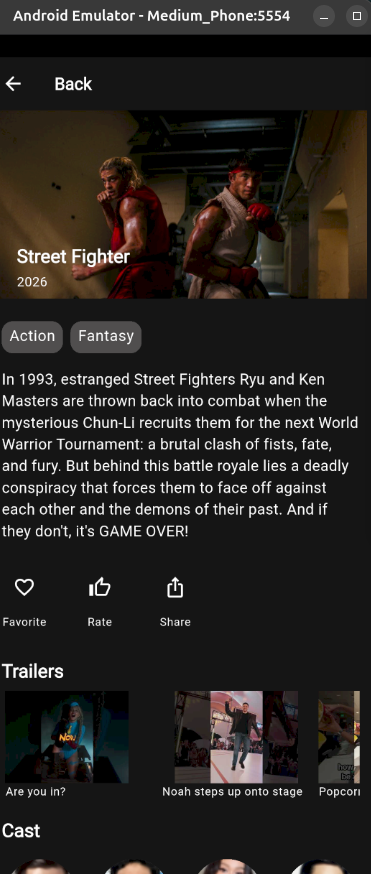
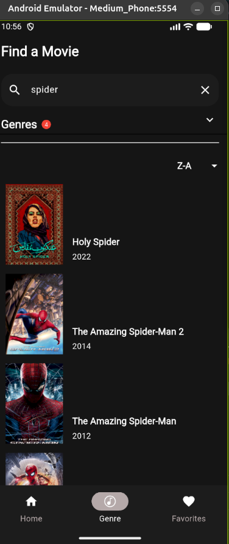
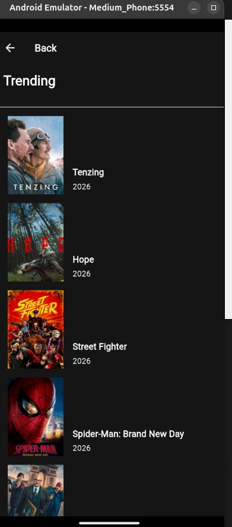
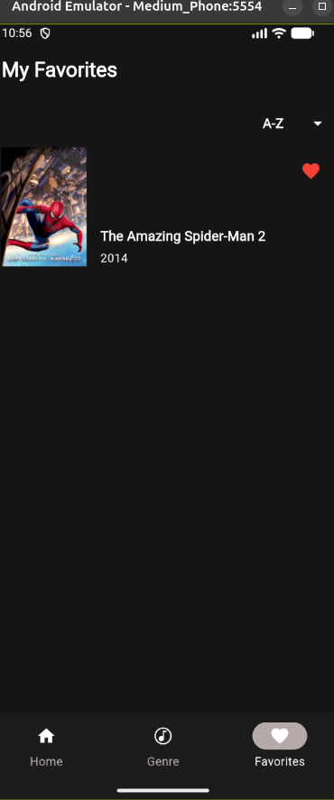
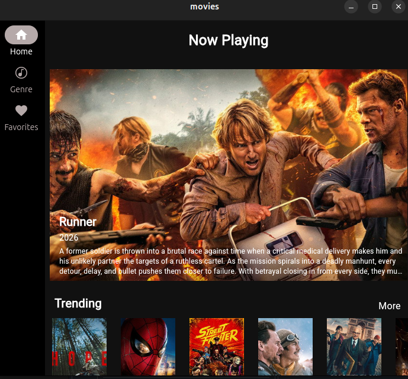

<p align="center">
  
</p>

<h1 align="center">Movies</h1>

<p align="center">
  A Flutter mobile app to discover movies, watch their trailers and manage your favorites.<br>
  Built as a hands-on project following the book <i>Mastering Flutter</i> by Kevin Moore.
</p>

---

## Screenshots

| Home | Details | Search | "More" listing | Favorites |
|:---:|:---:|:---:|:---:|:---:|
|  |  |  |  |  |

Linux desktop version, with a navigation rail on large screens:



## Features

- **Home screen**: carousel of movies now playing and *Trending*, *Popular* and *Top Rated* rows (real data from the TMDB API).
- **Full listings** for each category with **infinite scrolling**.
- **Search** by title and genre, with sorting (A-Z, Z-A, popularity, year).
- **Details page**: backdrop, genres, overview, **YouTube trailers** and cast.
- **Favorites** stored in the cloud (**Cloud Firestore**), synchronized in real time.
- **Sign in with Google** (Firebase Authentication).
- **Crash reporting** with Firebase Crashlytics.
- **Animations**: Hero transitions, fades, bounces, animated heart.
- **Adaptive layout**: bottom navigation bar on phones, navigation rail on large screens.
- **Native Kotlin plugin** (`movie_plugin`) to remember the selected genres.

## Repository structure

The repository contains three Flutter projects, side by side:

| Folder | Purpose |
|---|---|
| [`movies/`](movies) | The app (UI, navigation, view model, tests) |
| [`movie_data/`](movie_data) | Dart package: TMDB API, models, drift and Firestore databases, repository |
| [`movie_plugin/`](movie_plugin) | Native Android plugin (Kotlin): simple key/value storage |

```
movies/                 App
 ├─ lib/
 │   ├─ main.dart
 │   ├─ providers.dart  Riverpod providers
 │   ├─ router/         Navigation (AutoRoute)
 │   ├─ ui/             Screens, widgets, theme, view model
 │   └─ utils/          Utilities, preferences
 ├─ test/               Widget tests
 └─ integration_test/   Integration test
movie_data/             Data package
movie_plugin/           Native plugin
```

## Tech stack

| Area | Tools |
|---|---|
| Framework | Flutter 3.47, Dart 3.13 |
| State management | Riverpod 3 (with code generation) |
| Navigation | AutoRoute (deep links `movieapp://bpb.com/details/<id>`) |
| Networking | Dio, [The Movie Database (TMDB)](https://www.themoviedb.org/) API |
| Models | freezed, json_serializable |
| Databases | drift (local SQLite), Cloud Firestore |
| Firebase | Authentication (Google), Firestore, Crashlytics |
| UI | cached_network_image, card_swiper, flutter_animate, google_fonts, infinite_scroll_pagination, pod_player |
| Testing | flutter_test, integration_test |

## Getting started

### Requirements

- Flutter 3.47 or later ([installation](https://docs.flutter.dev/get-started/install))
- Android Studio (Android SDK and emulator)
- A free [TMDB](https://www.themoviedb.org/settings/api) API key
- A [Firebase](https://console.firebase.google.com/) project with Cloud Firestore and Google sign-in enabled

### 1. Clone the repository

```bash
git clone https://github.com/rantoangelo25/movies-flutter.git
cd movies-flutter
```

### 2. `.env` file

Keys are not published in this repository. Copy the template and fill it in:

```bash
cd movies
cp .env.example .env
```

```
TMDB_KEY='your_tmdb_key'
GOOGLE_WEB_CLIENT_ID='your_web_client_id.apps.googleusercontent.com'
```

### 3. Firebase setup

Firebase configuration files are not published either. Generate them for your own Firebase project:

```bash
dart pub global activate flutterfire_cli
flutterfire configure        # choose your project and the android platform
```

In the Firebase console:
- create a **Cloud Firestore** database;
- enable **Authentication → Google**, then copy the "Web client ID" into `.env`;
- add the **SHA-1** fingerprint of your Android debug key (and of your release key) in the Android app settings.

### 4. Generate code and run

```bash
# In movie_data
cd ../movie_data
flutter pub get
dart run build_runner build

# In movies
cd ../movies
flutter pub get
dart run build_runner build
flutter run
```

## Tests

```bash
# Plugin unit tests
cd movie_plugin && flutter test

# App widget tests
cd movies && flutter test test/widget_tests.dart

# Integration test (with an emulator running)
cd movies && flutter test integration_test/movie_tests.dart -d emulator-5554
```

## Release build (APK)

Signing uses an `android/key.properties` file and a keystore, which are **not published** in this repository.

```bash
cd movies
flutter build apk --release
# Output: build/app/outputs/flutter-apk/app-release.apk
```

## Changes from the book

The book was written on macOS for older versions of the tools. This project was built on **Ubuntu** with current versions, which required several adaptations: new APIs in Riverpod 3, AutoRoute 11, freezed 4, google_sign_in 7 and infinite_scroll_pagination 5, Android setup for Google sign-in, an Android-only plugin, and fixes for several bugs in the original code. Details are in the project report.

## Author

**Angelo RANTOANDRIANTSOA** — mobile development hands-on project, October 2026.

Based on the book *Mastering Flutter* by Kevin Moore (BPB Publications).

## Credits

This product uses the TMDB API but is not endorsed or certified by TMDB.
Movie data and images are provided by [The Movie Database (TMDB)](https://www.themoviedb.org/).

## License

© 2026 Angelo RANTOANDRIANTSOA — **all rights reserved**.
This code is published for viewing and evaluation purposes only; copying or reusing it
without the author's written permission is not allowed. See [LICENSE](LICENSE).
